<div align="center">

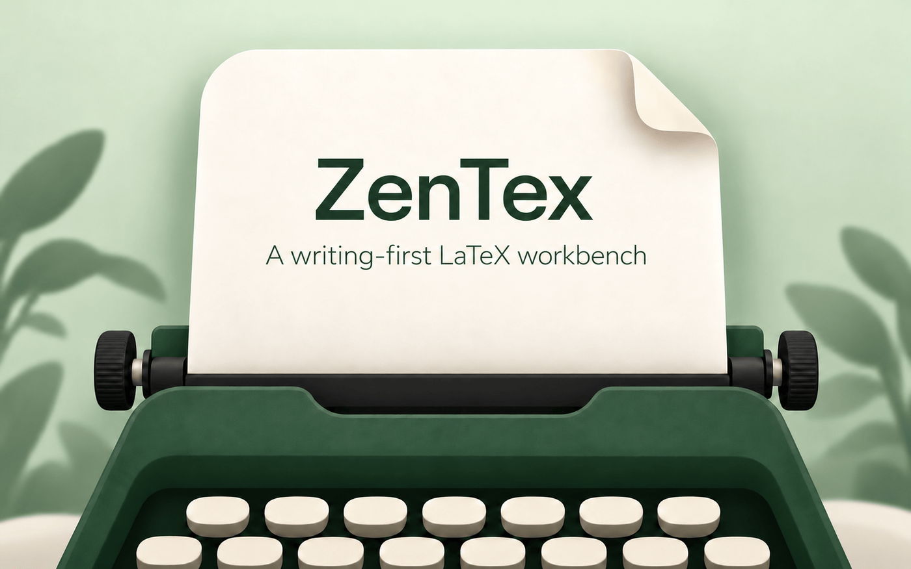

# ZenTex

**以写作为中心的 macOS LaTeX 编辑器 —— 原生 Swift 外壳，不依赖 Electron。**

源码始终是唯一的真相。一层装饰把章节、公式、表格、图片和引用**就地渲染**出来 —— 而你依然可以直接在上面打字。


[English](README.md) · **简体中文**

</div>

<p align="center">
  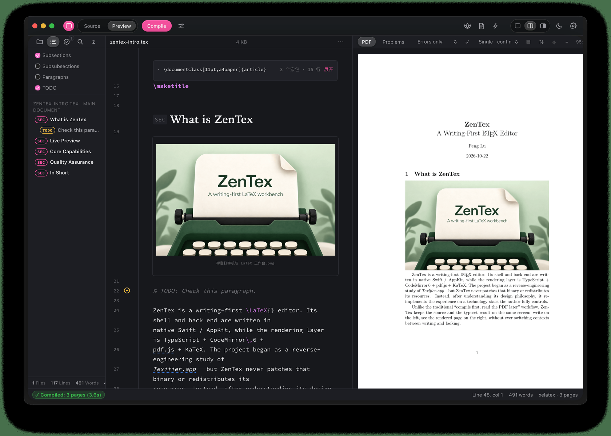
  <br><sub>分栏视图 —— 左边是同一份文本，右边是 <code>latexmk</code> 真正编译出的 PDF。始终只有一个真相。</sub>
</p>

---

## 目录

- [为什么做 ZenTex](#为什么做-zentex)
- [截图导览](#截图导览)
- [功能](#功能)
- [工作原理](#工作原理)
- [运行环境](#运行环境)
- [安装](#安装)
- [使用](#使用)
- [开发流程](#开发流程)
- [验证](#验证)
- [开发命令](#开发命令)
- [项目结构](#项目结构)
- [已知局限](#已知局限)
- [致谢与出处](#致谢与出处)
- [许可证](#许可证)

---

## 为什么做 ZenTex

用 LaTeX 写论文，意味着生活在两个视图之间：一边是纯源码，一边是编译出的 PDF。改一句话，要找两遍。有些编辑器能折叠导言区、把 `\section` 画成标题，但它的预览依然是**另一份渲染结果** —— 你是「看」它，而不是「在上面写」。

ZenTex 从一个问题出发：**如果渲染出来的视图*就是*源码本身呢？**

它保留经典的左右双栏工作流（左边源码、右边编译出的 PDF），并加上一层**装饰同一份文本缓冲区**的「预览」层：章节变成真正的标题，公式用 KaTeX 就地渲染，图片和表格直接内联显示，`\label` / `\cite` / `\ref` 折成 chip。把光标移进任何一块装饰区域，它就变回可编辑的源码。

- **原生 macOS 应用**（Swift + AppKit + WebKit）。整个应用包约 9 MB；它取代的 Electron 原型约 250 MB。
- **自包含。** 编辑界面（CodeMirror 6 + pdf.js + KaTeX）内嵌在应用里，从不自己读写你的文件系统。
- **只在本机。** 所有文件、编译、交叉引用操作都走一个只绑定 `127.0.0.1` 的极简 HTTP 服务 —— **绝不监听网络**。
- **单进程，无后台守护。** 服务跑在应用自己的进程里，退出即结束。

---

## 截图导览

> 所有截图均为 **v0.16.30** 实机截图（深色模式，2× 视网膜分辨率），所用稿件是一份中性的演示项目。浅色主题共用同一套设计令牌，可在设置中切换。

### 1 · 源码模式 —— 熟悉的 LaTeX，什么都不藏

<p align="center">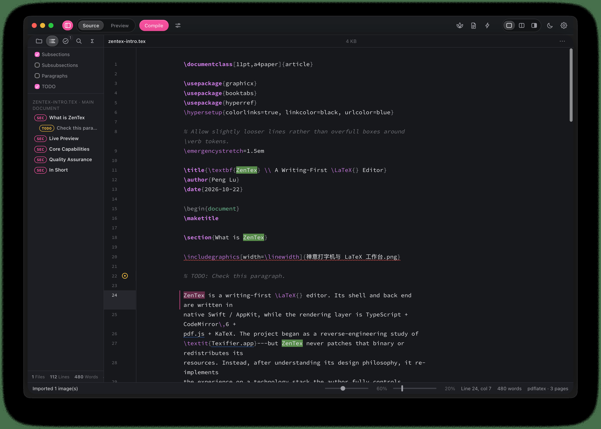</p>

语法高亮、文件树（`figs/`、`sections/`、`main.tex`、`refs.bib`），以及一条窄而易读的文本列。

### 2 · 预览模式 —— 同一个文件，加上装饰

<p align="center">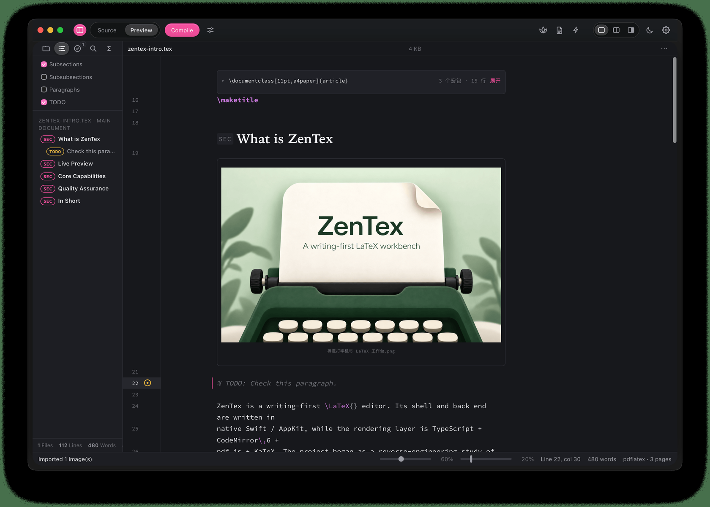</p>

导言区折成一行摘要条；`\section` 渲染成真正的标题（**显示你实际写的那个命令**：`SEC`，而不是 `PART`）；引用折成 chip。

### 3 · 公式与表格，就地渲染

| 公式与枚举 | 表格 |
| --- | --- |
| 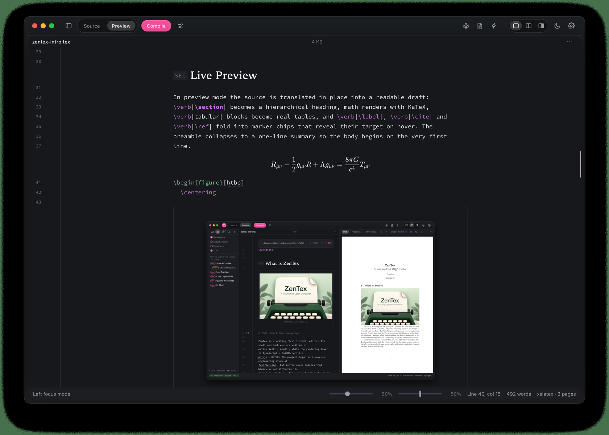 | 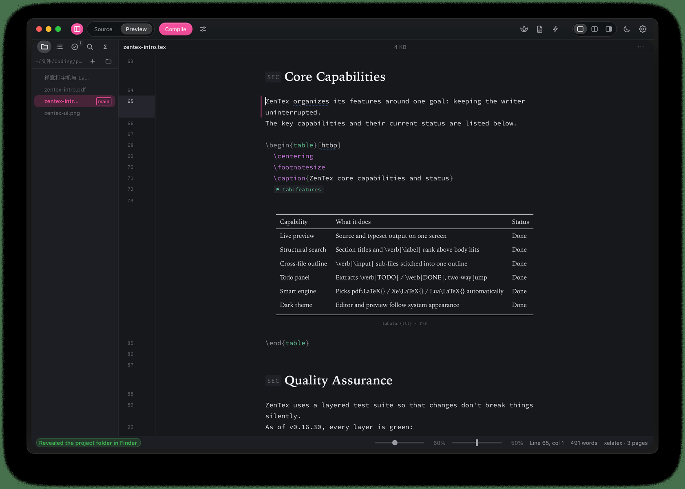 |
| KaTeX 公式和列表，就渲染在你打字的那一栏里。 | `tabular` 渲染成真正的表格 —— booktabs 线条也在。 |

### 4 · 项目工具

| 跨文件大纲 | 待办面板 |
| --- | --- |
| 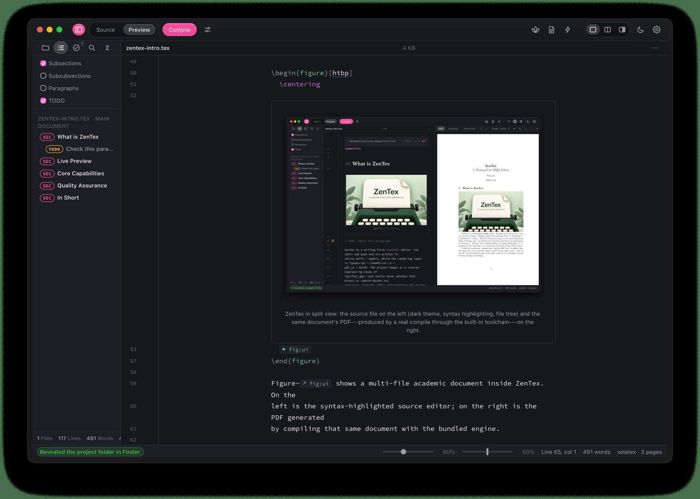 | 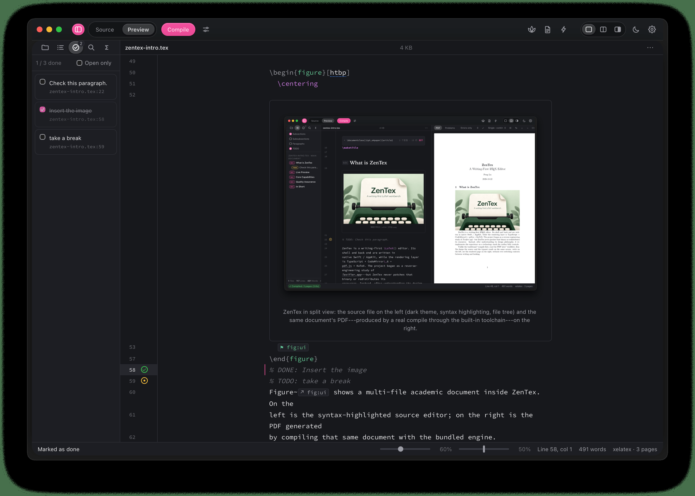 |
| `\input` 的子文件按阅读顺序就地拼接，层级在整个项目内统一归一。点击即跳到对应文件与行。 | 勾选**真的会改写源码**（`% TODO` ↔ `% DONE`，`\todo{}` ↔ `\done{}`）。 |

| 项目检索 | 引用补全 |
| --- | --- |
| 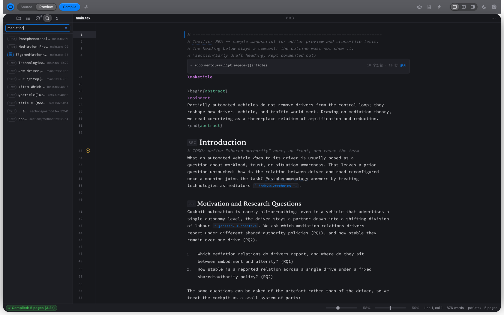 | 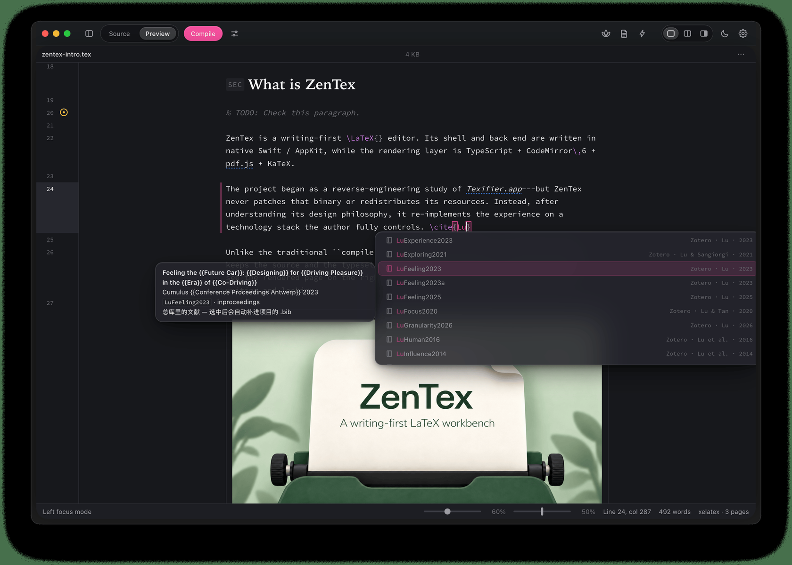 |
| 一个输入框，两类答案：先结构（标题、标签），后正文 —— 每条命中都带 `文件:行:列`。 | 在 `\cite{` 里打一个字母，就能看到来自所有 `.bib` 与跨文件 `\label` 的候选，并附作者、年份、出处。 |

### 5 · 专注模式与设置

| 专注模式 | 偏好设置 |
| --- | --- |
| 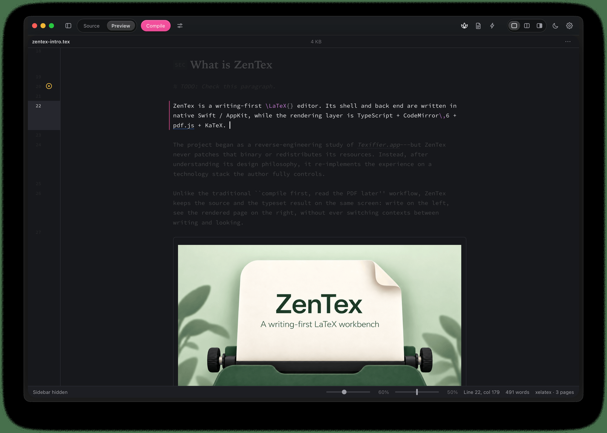 | 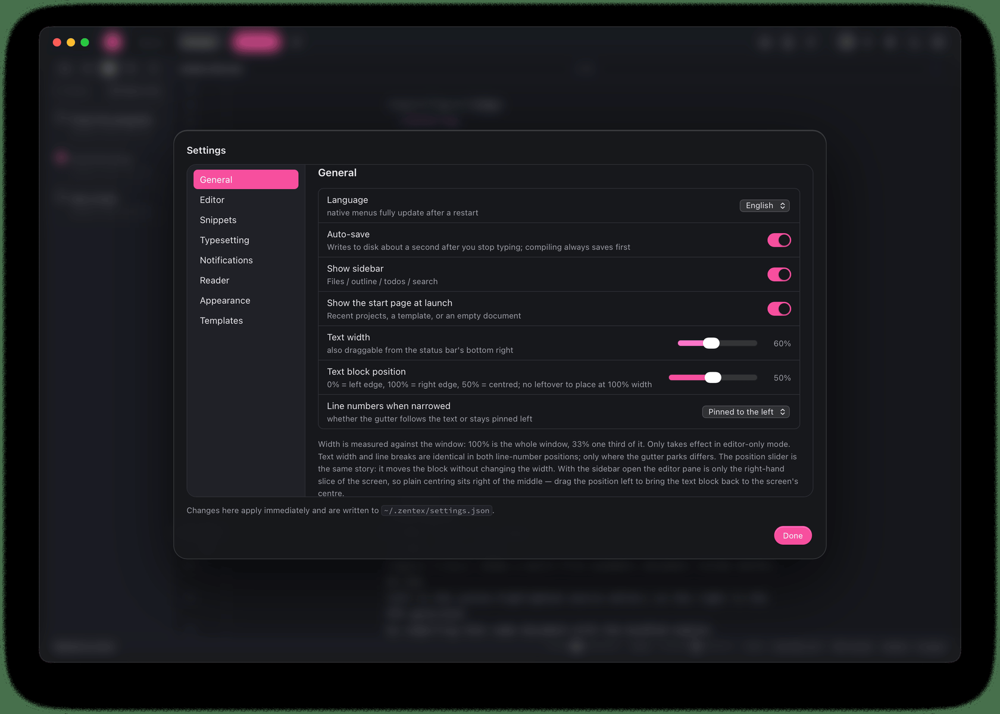 |
| 除正在写的那一段外，其余内容淡出。 | 三个分组 —— 编辑器辅助、排版、PDF 阅读器。保存在 `~/.zentex/settings.json`，每个字段读取时都会校验。 |

---

## 功能

- **层级化源码编辑器。** 一个 CodeMirror `StateField` 装饰层：折叠导言区、把 `\section`/`\subsection` 渲染成标题、用 KaTeX 就地渲染行内/行间公式、内联显示 `\includegraphics` 与 `tabular`、把 `\label`/`\cite`/`\ref` 折成 chip。标题层级**按文档归一化**，所以同一份源码在 `article` 和 `book` 下都能得到合理的层级。
- **「中间态」所见即所得。** 预览模式不是另一份渲染结果，而是同一份源码上的一层装饰，你可以直接在上面打字。行内格式像 Markdown 编辑器一样工作：`⌘B` / `⌘I` / `⌘U` 对 `\textbf{}` / `\textit{}` / `\underline{}` **幂等地包裹与解包**，支持多光标与反向选区。
- **带 SyncTeX 的 PDF 预览。** pdf.js 渲染编译出的 PDF；可从源码跳到 PDF 页，也可在 PDF 上点击跳回源码行。九种页面模式（含「双页 · 封面」）、缩略图条、缩放与滚动锁定。智能引擎探测会根据文档和项目配置自动选 `pdflatex` / `xelatex` / `lualatex`。
- **引用与补全。** `.bib` 解析、项目级标签索引、15 个内置片段及热键（`<SELECTION>` 包裹选区）、环境模板、智能选择。引用编号**刻意不去预测** —— LaTeX 的编号是编译期的决定。
- **项目工具。** 文件树、跨文件大纲、待办追踪、项目统计、标签搜索、项目全文检索、查找与替换、带用户词典的拼写检查，以及打字停顿后的自动排版。
- **深色模式 + 自定义 CSS。** 编辑器、预览、外壳共用同一批设计令牌（`src/theme/tokens.css`，`--ltx-*` 前缀）。「浅色 / 深色 / 跟随系统」切换的只是 `<html data-theme>`。在 **设置 → 外观** 里可贴任意 CSS，它会被最后注入并覆盖一切。
- **中文开箱即用。** `ctex` 模板走 XeLaTeX / LuaLaTeX 编译；另有中文标点面板、手动指定 TeX 发行版路径。界面本身提供中英双语。
- **构造上就安全。** 渲染层从不读写文件；Swift 后端拒绝任何逃出项目根的路径，且只监听回环地址。

---

## 工作原理

三层，各自职责清楚：

```
ZenTex.app
├── Swift 外壳（AppKit + WebKit）
│   ├── NSWindow + WKWebView            渲染界面
│   ├── NWListener（Network.framework） 本地 HTTP 服务，只绑 127.0.0.1
│   ├── Process                         调用 latexmk / synctex
│   └── 原生菜单、NSOpenPanel、拖放打开文件夹
├── 渲染层（TypeScript + CodeMirror 6 + pdf.js + KaTeX）
│   └── 内嵌在 Contents/Resources/web，不碰文件系统
└── 本机 TeX 发行版
    └── latexmk → PDF + .synctex.gz
```

**中间态的三条规则。** 预览是一个 CodeMirror `StateField`，在同一份缓冲区上绘制装饰：

1. **光标会还原。** 光标移进装饰区域，它立刻变回可编辑的源码。
2. **嵌套区域不叠加。** 外层优先 —— 不会出现套娃式的 widget。
3. **每个文档状态只扫描一次。** 解析结果有缓存，打字不会触发整篇重扫。

**为什么是「原生外壳 + WebView」而不是纯原生控件？** 体验的核心是**在文本之上做一层可编辑的装饰**（标题、公式、图片、表格、chip）。CodeMirror 的 `StateField` / `Decoration` 模型正是这个问题的成熟解，用 `NSTextView` 重写一遍成本更高、收益更小。所以窗口、菜单、文件对话框、进程管理这些**外壳**用原生 Swift，编辑体验用 web 技术。

**后端也是 Swift。** 原先的 Node 参考实现（`host/*.mjs`）被逐文件移植到 `swift/Sources/ZenTex/`：HTTP 服务、路径防护、文件树、主文件探测、`latexmk` 调用、`.log` 解析、SyncTeX 双向跳转。HTTP 契约**逐字段一致**，前端因此一行都不用改。`host/*.mjs` 保留为参考实现，也是 `npm run dev` 的开发后端。

---

## 运行环境

- **macOS 13 Ventura 或更高版本。**
- 标准构建**需要一套 TeX 发行版** —— 已验证 TeX Live 2026 与 MacTeX（需已安装 `latexmk`、`pdflatex`、`synctex`）。
  - *实验性*：`appstore` 分支把精简 TeX 发行版**内嵌进应用**（约 380 MB），因此可在**没有系统 TeX** 的 Mac 上编译，也是探索上架 Mac App Store 的基础。它独立成支线，主线新特性按需移植。
- **从源码构建**另需 **Node.js 20+** 与 **Xcode Command Line Tools**（或 Xcode）。

---

## 安装

### 下载预编译磁盘镜像

在 [Releases](../../releases) 页面下载最新的 `ZenTex 0.16.30.dmg`，双击挂载，把 **ZenTex** 拖进 **Applications**。

> 构建为 ad-hoc 签名、未公证，首次启动 macOS 可能提示「无法验证开发者」。右键 → **打开**，或执行：
> ```bash
> xattr -dr com.apple.quarantine "/Applications/ZenTex.app"
> ```

### 从源码构建

```bash
npm install
npm run app          # 构建前端 → 编译 Swift → 组装并启动 ZenTex.app
```

产出的 `ZenTex.app` 自包含（约 9 MB）。要生成可直接分发的安装包：

```bash
npm run dmg          # 用现有 .app 打包成 ZenTex 0.16.30.dmg
npm run dmg:fresh    # 重新组装 .app 再打包
```

---

## 使用

1. **首次启动**会让你选择 LaTeX 项目文件夹；之后每次打开都回到上次的项目，用 `⌘O` 切换。
2. 在左栏**写作**。工具栏的「源码 / 预览」开关控制装饰层的开合。
3. 用工具栏按钮（或排版快捷键）**编译**。PDF 出现在右侧；错误带文件和行号显示在问题面板。
4. 通过定位按钮或在 PDF 上点击，在**源码与 PDF 之间跳转**（SyncTeX）。
5. **设置**（`⌘,`）涵盖外观、引擎、拼写，以及一个自由 CSS 输入框。

| 快捷键 | 作用 |
| --- | --- |
| `⌘O` | 打开 / 切换项目 |
| `⌘,` | 设置 |
| `⌘B` / `⌘I` / `⌘U` | 包裹 / 解包 粗体 / 斜体 / 下划线 |
| `⌘F` · `⌘G` / `⇧⌘G` | 查找 · 下一个 / 上一个匹配 |
| `⌘E` | 用选区作为查找内容 |
| `Ctrl-<字母>` | 插入内置片段（基键可切成 `Ctrl+Shift`） |

---

## 开发流程

ZenTex 由一人独立完成，从设计、编辑器架构、Swift 外壳与后端，到打包流水线与验证体系。它源自作者自己的学术写作 —— 一篇含跨文件 `\input`、引用与表格的稿件，而现有编辑器总逼你在「干净的源码」和「可读的预览」之间二选一。

### 五步故事线

1. **定义问题。** 两个视图（源码 / PDF）意味着每次修改都要找两遍；而「另一份渲染」的预览只能被看，不能被写。
2. **先研究参照物。** 动手写代码前，先完整梳理了一款现有 macOS LaTeX 编辑器（Texifier 1.9.33）—— 全部 **1025** 个字符串表键、NIB 菜单树、真实的 `NSUserDefaults` 键名。然后在同一套 LaTeX 工具链（`latexmk`、SyncTeX、TeX Live）上**从零重新实现**，**不修改参照应用的二进制，也不再分发它的资源**。盘点清单与逐项对照矩阵放在 `docs/`。
3. **用 Web 技术栈做原型。** 第一版原型是 Electron + Node 参考后端（约 250 MB）。
4. **转向原生。** 外壳迁到 Swift/AppKit，后端逐文件移植为 Swift，并保持 HTTP 契约不变 —— 应用降到约 9 MB，不再需要 Electron 与 Node 运行时。
5. **打磨与证明。** 围绕写作手感长期迭代，最后建立六层验证流水线（见下），并在**成品只读磁盘镜像内部**再跑一遍自检。

### 版本时间线

逐版本的完整记录见 [CHANGELOG.md](CHANGELOG.md)。里程碑如下：

| 版本 | 里程碑 |
| --- | --- |
| 0.4 | 窗口拖动、菜单栏与图标页签修复 |
| 0.5 | 界面收敛；跟随 macOS 系统强调色 |
| 0.6 | 排版完成通知 |
| 0.7 | 可调编辑列宽与**专注模式** |
| 0.8 | 设置分类重组、菜单合并 |
| 0.9 | 补全弹窗：新材质与图标 |
| 0.10 | **正式更名 ZenTex**；处理分三层的图标缓存 |
| 0.11 – 0.12 | 花括号自动补全；预览模式里回车续写列表条目；接受补全后提示自动回来 |
| 0.13 – 0.14 | 窄文本列下的行号；PDF 按原长宽比缩放；首次打开自动载入同名 PDF；专注模式与深色模式解耦 |
| 0.16.6 | **写中文**：一个模板、一次预检 |
| 0.16.9 – 0.16.13 | PDF 选中、链接、捏合缩放；拼写用户词典；智能选择；编辑器右键菜单 |
| 0.16.16 – 0.16.22 | 智能引擎学会读项目编译配置与 LuaLaTeX 专属信号 |
| 0.16.23 | 手动指定 TeX 发行版路径 + 中文标点面板 |
| 0.16.24 – 0.16.30 | 待办双向跳转（正文 gutter 标记 ↔ 侧栏卡片）、可开关的待办行号追踪、新 label 即时入索引，以及大量预览模式稳定性修复 |

### 打包流水线

`npm run dmg` 会组装 `.app`，用**纯 Python 直接写出** Finder 布局的 `.DS_Store`（构建机上 Finder 自动化被挡），用 `hdiutil` 生成压缩 `UDZO` 镜像，校验 ad-hoc 签名，最后挂载成品镜像，**从只读卷里直接跑一遍 app 自检**。

### 维护者须知

- `scripts/build-mac.mjs` 刻意**绕开 `xcrun`**，直接按绝对路径调用 `swiftc`。如果这台机器从未接受过 Xcode 许可协议，`xcrun` 在非交互环境下会卡在许可提示上；而按绝对路径调用编译器本身完全正常。
- 构建会做一次 **ad-hoc 签名**（`codesign --sign -`）。在 Apple Silicon 上这不是可选项 —— 改过 `Info.plist` 后原始签名失效，未签名的 arm64 应用会被内核直接拒绝。工具链报错时，`sudo xcodebuild -license accept` 能根治。
- 图标是 `assets/icon.png`（一台复古打字机压着一页稿纸，1024×1024，不含文字）。`scripts/icon-master.py` 负责去白 / 裁切 / 羽化；`build-mac.mjs` 再用 `sips` + `iconutil` 打成 `app.icns`。

---

## 验证

六层互相独立的验证。数字对应 **v0.16.30**。

| 命令 | 覆盖范围 | 结果 |
| --- | --- | --- |
| `npm run typecheck` | `tsc --noEmit` | 0 错误 |
| `npm test` | 前端纯函数：LaTeX 扫描器、`.bib` 解析、标签索引、日志解析、包裹/解包决策矩阵、图注拍平、项目检索、待办源码改写、自动排版状态机、页面模式算术、片段展开、大纲/待办/统计、设置校验…… | **667** 通过 |
| `npm run selftest` | Swift 后端：起**真实 HTTP 服务、发真实请求**，覆盖全部 **39** 个接口；路径逃逸防护（`../../etc/passwd` 必须 `403`）、编译出 PDF、SyncTeX 双向、菜单结构、拖动遮罩命中测试、通知判定表、ChkTeX 检查 | **237** 项 |
| `npm run check:templates` | 六个内置模板逐个用 `latexmk` 真编译（`ctexart` 走 XeLaTeX） | 6 / 6 |
| `npm run smoke` | 生产构建下的真实浏览器端到端（真 Chrome、真敲键、真编译） | **871** 项 |
| `npm run dmg` | 挂载成品镜像、`codesign --verify`，再**从只读镜像里直接跑 app 自检** | 10 / 10 |

`selftest` 与 `smoke` 都不会碰**你自己的**偏好文件：设置存放在浏览器 profile 之外（`~/.zentex/settings.json`），测试用 `REA_CONFIG` 把配置指到临时目录；冒烟在开跑前快照、先杀浏览器再逐字节还原。

---

## 开发命令

| 命令 | 作用 |
| --- | --- |
| `npm run app` | 构建前端、编译 Swift、组装并启动应用 |
| `npm run build:mac` | 只构建，不启动 |
| `npm run dmg` / `npm run dmg:fresh` | 把当前 `.app` 打包 / 重新组装后再打包 |
| `npm run icon` | 重新生成应用图标 |
| `npm run refresh-icon` | 重注册并清除图标缓存（Dock 显示旧图标时） |
| `npm run selftest` | Swift 后端无头自检 |
| `npm run typecheck` | `tsc --noEmit` |
| `npm test` | 前端单元测试 |
| `npm run smoke` | 真实浏览器端到端验证（需要 Chrome） |
| `npm run dev` | 前端开发模式：Vite + Node 参考后端，热更新 |

---

## 项目结构

```
swift/Sources/ZenTex/          Swift 外壳 + 后端
  main.swift                   入口；--selftest 走无头模式
  AppDelegate.swift            窗口、菜单、NSOpenPanel、拖放
  HTTP.swift                   Network.framework 上的极简 HTTP/1.1（只绑回环）
  Router.swift                 路由；契约与 Node host 逐字段一致
  Project.swift                文件树、路径限制、主文件探测
  LaTeX.swift                  latexmk 调用 + SyncTeX 双向
  LogParser.swift              .log → 结构化诊断
  ProcessRunner.swift          子进程 + 硬超时 + 输出捕获
  Toolchain.swift              找 TeX Live、修补 GUI 应用的 PATH
  AppState.swift               项目根、设置、自定义 CSS
  StaticFiles.swift            界面资源服务
  SelfTest.swift               后端自检
scripts/
  build-mac.mjs                编译 Swift → 组装 .app → 内嵌 dist → ad-hoc 签名
  build-dmg.mjs                .app → 可写镜像 → Finder 布局 → UDZO → 校验
  dmg-layout.py                直接写 .DS_Store（绕开被挡住的 Finder 自动化）
  selftest.mjs                 按需重编译后跑后端自检
  refresh-icon.mjs             刷新图标缓存；报告够不着的那一层
  icon-master.py               母图去白 / 裁切 / 羽化
  smoke.mjs                    真实浏览器端到端验证
  dev.mjs                      前端开发模式：Node host + Vite
host/                          Node 参考实现（保持行为一致）
src/editor/                    LaTeX 扫描器、分词器、装饰、widget、补全
src/app/                       设置模型、分栏布局、侧栏、自动排版、api
src/preview/                   pdf.js 渲染、页面模式、问题面板
src/theme/tokens.css           设计令牌 —— 编辑器与预览的共同真相
tests/                         单元测试
docs/                          截图与设计说明
project/                       示例 LaTeX 项目
```

---

## 已知局限

坦率写出的边界，而不是藏起来：

- 打字时没有连续的滚动跟随（SyncTeX 的双向跳转可按需使用）。
- 行内格式快捷键覆盖六个样式族；其他命令能渲染，但不在快捷键族内。
- `ctex` 模板需要 XeLaTeX 或 LuaLaTeX。
- 在未接受 Xcode 许可协议的机器上，`biber` 可能失败（`lipo`）；biblatex 项目会回退到 BibTeX 链。
- 界面为中英双语，但有**一处已知遗漏**：预览模式里折叠的导言摘要条是硬编码中文（截图中可见）。
- 标准构建为 ad-hoc 签名，未经公证。

---

## 致谢与出处

- 独立重新实现：不修改、也不再分发任何第三方应用的二进制，仅复用同一套 LaTeX 工具链（`latexmk`、SyncTeX、TeX Live）。
- 构建于 [CodeMirror 6](https://codemirror.net/)、[pdf.js](https://mozilla.github.io/pdf.js/) 与 [KaTeX](https://katex.org/)，遵循各自的开源许可。
- 应用图标（打字机）、窗口与界面设计：作者本人。
- 截图所用稿件是一份中性演示文稿（关于人车协同驾驶中技术中介的后现象学论述），不含任何私人内容。

ZenTex 受严肃 LaTeX 写作者所依赖的「专用源码 / PDF 双栏工作流」，以及那些让长文档写起来不那么痛苦的诸多小便利所启发。

---

## 许可证

目前仓库**还没有 LICENSE 文件**。发布前请补一个（MIT 或 Apache-2.0 是常见选择）。在补上之前，保留所有权利。
